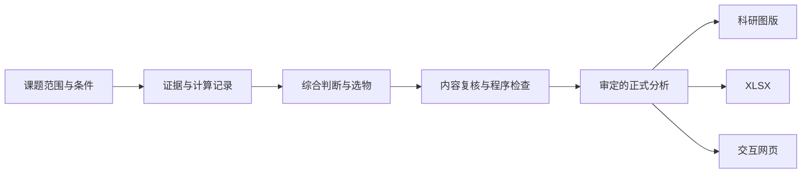

# 鱼类毒性研究工作流

**Fish Toxicology Research** 是一套面向鱼类与有机污染物毒性研究的AI辅助工作流。它将资料数据库、实验与计算证据、逐候选机制推导和实验代表物选择组织到同一研究过程中，形成可追溯的相对风险判断，以及科研图版、Excel工作簿和交互网页。

项目适用于候选物较多、证据来自不同物种或实验条件、需要决定下一步优先验证哪些物质的研究。物种、候选家族、参照物、通路、终点和实验条件由具体课题确定。

**[下载完整工作包](https://github.com/Accsy7/fish-toxicology-research/releases/latest/download/fish-toxicology-research-workpack.zip)** · **[装载教程](docs/装载教程.md)** · **[版本与下载](https://github.com/Accsy7/fish-toxicology-research/releases)**

## 可以完成什么

围绕一个明确的研究问题，工作流要求形成三类相互关联的结果：

| 研究任务 | 结果应回答的问题 |
| --- | --- |
| 全候选比较 | 在给定物种、终点与暴露条件下，哪些候选物预计风险较高、较低或暂时无法区分？ |
| 逐物质推导 | 判断由哪些实验、机制和计算证据支持？依赖什么条件？有哪些反证，置信程度如何？ |
| 实验代表物选择 | 每个实验名额检验什么未解决的问题？为何选择它？不同结果会更新哪些候选物的判断？ |

风险分组与实验名单分别形成。代表物可以用于检验机制分歧、证据冲突或类推边界，因此实验名单不必等同于风险最高的若干物质。

## 快速开始

1. **下载并解压完整工作包。** 工作包包含工具、报告模板和资料数据库。GitHub自动提供的Source code压缩包仅含源码，不含数据库。
2. **接入自己的课题。** 在AI客户端中打开已有项目或空文件夹，按[装载教程](docs/装载教程.md)完成对应软件的操作，再把包内的`toolkit/INSTALL.md`交给AI：

   > 把这个研究工具接入当前项目。

3. **直接说明研究问题。** 可以同时提供论文、候选清单和已有实验安排，例如：

   > 研究双酚类对斑马鱼的雌激素相关毒性，以BPA为参照，比较风险并选出实验代表物。

AI根据研究问题整理课题配置、检查资料与运行环境，再开展分析。真正影响判断而现有材料无法确定的条件，会集中向研究者确认；用户无需先编写JSON或完整任务书。

本地成果保存在自己课题目录的`research/`中。再次打开同一项目即可继续，原始资料与旧版本保留。各客户端的文件访问方式不同，教程分别介绍WorkBuddy、DeepSeek Harness、Claude Code、Claude Cowork／Desktop、Codex和ChatGPT。

## 工作原理

工作流以本课题的研究条件为起点，由AI执行证据分析和科学推导，程序处理可明确检查的记录与数据关系。完整流程如下：

### 数据库、AI与程序的分工

| 组成 | 职责 |
| --- | --- |
| 资料数据库 | 保存物质身份、来源、实验对象、条件、终点及已有计算，支持查询和证据提取。 |
| AI与研究者 | 检索原始材料，判断方法适用性与证据冲突，形成机制解释、条件预测、风险分组和代表物建议，并进行内容复核。 |
| 计算与检查工具 | 按选定方法保存输入、参数和结果；检查范围、记录依赖、版本及导出一致性。具体计算工具按课题需要配置。 |
| 正式分析与生成器 | 保存审定数据和正文，通过明确字段映射生成图版、工作簿和网页，保持不同交付中的判断一致。 |

工具包提供的本地程序包括资料查询、证据提取、空白课题初始化、成果登记、完成记录检查和审定内容导出。科学判断由分析AI依据来源形成；程序检查通过仅表示对应检查条件满足，科学内容仍须回到原材料和实际计算记录复核。

### 如何从证据形成判断

**先检查可比性。** 实验结果按“原研究—实际物质或制剂—研究对象—条件—终点”归属。不同物种、剂量、时长、检测方式和存活背景会影响类推；同一论文涉及多个物质时，分别确定证据贡献。

**再区分证据层级。** 原始观察、机制解释、计算比较和待验证预测分别记录。结构相似性与对接结果用于支持相应的计算或机制假说；将其推及毒性表型时，需要说明条件及反证。同靶点比较保留协议、单位和稳定性信息。

**保留可以检验的预测。** 每个候选写明预测方向、相对参照的判断、决定性依据、适用前提、置信程度，以及什么实验结果会改变哪项判断。证据允许部分排序或并列；方法受阻时，记录已尝试的办法、替代分析和影响范围，继续其他可开展的工作。

**按验证价值选择代表物。** 每个名额对应一个研究问题，并说明替代候选、预期结果的判别作用和可能更新的未测成员。代表物验证与全家族结论之间的适用范围需要单独说明。

具体要求见[研究流程与完成标准](toolkit/skill/references/research-workflow.md)及[质量检查规范](toolkit/skill/references/quality-review.md)。

## 交付内容

三种成果读取同一份审定分析。科学内容修改后先更新分析与复核记录，再重新生成，导出阶段不补写新的科学判断。

| 交付 | 内容与用途 |
| --- | --- |
| 科研图版与数据 | 按证据选择适用图形，提供图注、对应数值或结构信息，以及SVG、PDF、PNG导出。 |
| 00—07 XLSX | 依次组织研究范围、代表物建议、全候选预测、逐物质依据、实验依据、计算核查、目标鱼蛋白范围、参考成员与来源。 |
| 交互网页 | 通过全家族比较、机制与逐物质推导、结构／计算／实验比较、代表物与验证四个入口阅读；支持概览、按需详情、来源查看和文件下载。 |

网页正文与表格可复制到Word。独立DOCX报告不属于默认交付。格式规则见[交付规范](toolkit/skill/references/accepted-formats.md)。

## 数据与版本管理

完整工作包附带可供取证的资料库快照和浏览页面。数据库中的历史结果保留其来源与研究条件，新课题从自己的问题和证据开始形成判断；已有数据的收录范围也不等于本课题的全部研究范围。

各课题单独保存原始材料、计算记录、正式分析、复核记录和交付版本。资料库默认只读，新研究成果按课题登记。完整校验值、程序日志和修改经过保存为核查资料，科研正文保留理解判断所需的内容。

本仓库提供研究skill、查询与导出程序、空白报告模板和客户端适配包；完整数据库及运行依赖通过[Release工作包](https://github.com/Accsy7/fish-toxicology-research/releases/latest)分发。新增绘图或计算依赖由AI按课题在项目环境中配置。

## 当前验证范围

已完成本地项目安装、已有文件保护、只读查库、证据提取、工作簿与网页导出一致性检查，以及公开Release下载核验。各客户端界面尚未逐一实测，新的真实课题完整科学迁移验收尚未完成。

这套流程用于组织证据、提出有条件的预测并支持实验决策。预测的可靠性取决于原始资料质量、条件可比性和机制适用性；实际实验仍需研究者确认材料、暴露条件、对照和样本设计，并遵循所在实验室的操作规范。
