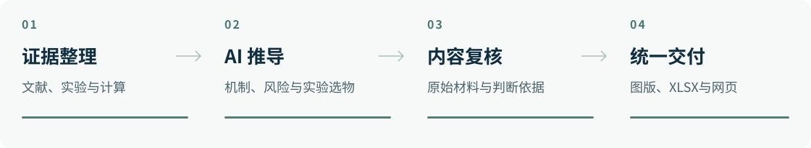

<strong>简体中文</strong> · <a href="README.en.md">English</a>

  

  <strong><a href="https://github.com/Accsy7/fish-toxicology-research/releases/latest/download/fish-toxicology-research-workpack.zip">下载完整工作包</a></strong>　 /　
  <a href="docs/装载教程.md">装载教程</a>　 /　
  <a href="docs/工作原理.md">推导与计算原理</a>

面向**鱼类与有机污染物毒性研究**的AI插件，集成SQLite资料库、数据库浏览前端、证据驱动的机制推导skill及计算与可视化工具，用于候选物风险比较、实验代表物选择和研究成果输出。

## 插件组成

<picture>
  <source media="(max-width: 600px)" srcset="docs/assets/workflow-mobile.svg">
  
</picture>

AI综合来源、条件和反证，形成可检验的预测；风险分组与实验名单分别确定。内容复核通过后，图版、XLSX和网页读取同一份审定分析。[了解推导过程 →](docs/工作原理.md)

## 开始一个课题

1. **准备项目。** 下载并解压完整工作包，另建自己的课题文件夹。
2. **装载插件。** 按[教程](docs/装载教程.md)选择客户端，将包内`toolkit/INSTALL.md`交给AI：**“把这个研究工具接入当前项目。”**
3. **提出研究问题。** 说明物种、候选物和关注的效应，附上已有资料或实验安排。例如：

   > 研究双酚类对斑马鱼的雌激素相关毒性，以BPA为参照，比较风险并选出实验代表物。

成果存入课题目录的`research/`。下次打开同一项目即可继续。

## 研究成果

| 科研图版 | 分析工作簿 | 交互报告 |
| :--- | :--- | :--- |
| SVG · PDF · PNG 图注与对应数据 | 00—07 XLSX 预测、依据与实验记录 | 网页概览与逐物质详情 筛选、来源与文件下载 |

网页正文与表格可复制到Word。物种、物质范围、通路及实验条件均由课题输入。

<strong>下载内容与适用范围</strong>

- **完整工作包**包含插件、SQLite数据库快照、SQL表结构和浏览前端；**源码仓库**包含skill、查询与导出程序、模板和客户端适配文件。
- 资料库收录化合物身份与结构、实验条件与效应、基因与蛋白及来源记录，使用时保持只读。新增课题按实际范围补充资料；历史判断保留其原有条件。
- 工具提供查询取证、计算记录核查、绘图和导出。分子对接等专项计算由AI根据适用性另行配置。
- 已完成本地安装、查库和XLSX／网页导出检查；各客户端界面及非BMP新课题的完整科学迁移尚未全部验收。预测保留条件与置信程度，可靠性取决于证据质量和方法适用性。

