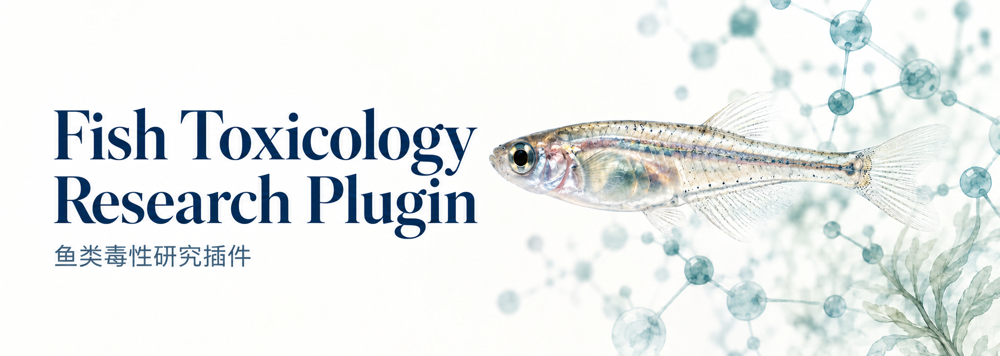
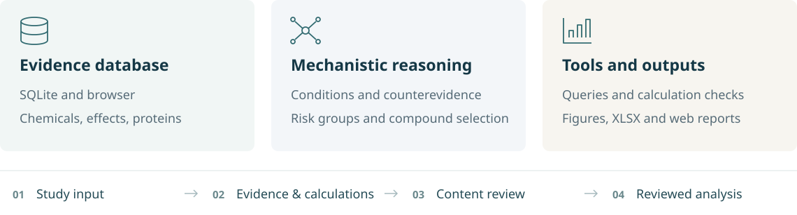

<strong>English</strong> · <a href="README.zh-CN.md">简体中文</a>

  

  <strong><a href="https://github.com/Accsy7/fish-toxicology-research/releases/latest/download/fish-toxicology-research-workpack.zip">Download full package</a></strong>　 /　
  <a href="https://github.com/Accsy7/fish-toxicology-research/blob/main/docs/INSTALL.en.md">Installation</a>　 /　
  <a href="docs/METHODS.en.md">How it works</a>

An AI plugin for studying **the toxicity of organic pollutants in fish**. It combines a SQLite database, a database frontend, AI analysis and computational tools to compare risks and select compounds for experiments.

## What is included

<picture>
  <source media="(max-width: 600px)" srcset="docs/assets/workflow-mobile-en.svg">
  
</picture>

The AI uses research findings and experimental conditions to make testable predictions, taking conflicting evidence into account.

## Start a study

1. **Prepare your project.** Download and extract the full package, then create a separate folder for your study.
2. **Load the plugin.** Follow the [client guide](https://github.com/Accsy7/fish-toxicology-research/blob/main/docs/INSTALL.en.md). Give the AI the package's `toolkit/INSTALL.md` and ask: **“Connect this research tool to the current project.”**
3. **Describe the research question.** Specify the species, candidates and effects of interest. Add existing papers or experimental plans. For example:

   > Study the estrogen-related toxicity of bisphenols in zebrafish. Use BPA as the reference, compare relative risks, and select representative compounds for experiments.

Outputs are saved in your project's `research/` directory. Reopen the same project to continue.

## Research outputs

| Scientific figures | Analysis workbook | Interactive report |
| :--- | :--- | :--- |
| SVG · PDF · PNG Captions and underlying data | 00–07 XLSX Predictions, evidence and experiments | Web overview and candidate details Filters, sources and downloads |

<strong>Package contents and scope</strong>

- The **full package** includes the plugin, a SQLite database snapshot, its SQL schema and a browser. The **source repository** includes the skill, query and export programs, templates and client adapters.
- The database stores chemical identities and structures, experimental conditions and effects, genes, proteins and source records. New studies supplement the evidence for their own scope.
- Tools cover evidence queries, calculation-record checks, plotting and exports. Specialized calculations, such as molecular docking, are configured separately when appropriate.

## Version 1.5.0

Updates back up plugin files and preserve research files and database settings. Excel workbooks and web reports support configurable layouts, with fixes for long text, negative chart values and empty datasets.

[Release notes](CHANGELOG.md) · [Installation and updates](INSTALL.en.md)

## License

Code: [MIT](LICENSE). Research instructions, documentation, figures and templates: [CC BY 4.0](LICENSES/CC-BY-4.0.txt). Database compilation: [ODC-By 1.0](LICENSES/ODC-By-1.0.txt). Code examples use MIT; original explanatory text in the database uses CC BY 4.0. Third-party content retains its own [licenses and attribution](THIRD_PARTY_NOTICES.md).
