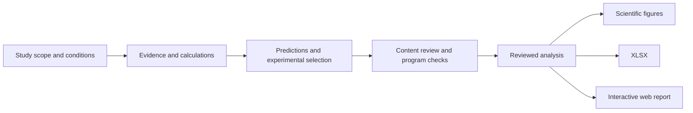

# Reasoning and computation

[简体中文](工作原理.md) · [Project overview](../README.en.md)

The plugin starts from the conditions of the current study. The AI interprets evidence and develops scientific judgments; programs manage records, reproducible operations and explicit consistency checks.

## Responsibilities

| Component | Role |
| --- | --- |
| Evidence database | Stores chemical identities, sources, experimental systems, conditions, endpoints and existing calculations for queries and evidence extraction. |
| AI and researcher | Retrieve original materials, assess method suitability and conflicting evidence, develop mechanistic interpretations, conditional predictions, risk groups and experimental selections, and review their content. |
| Computational and validation tools | Preserve inputs, parameters and results; check scope, dependencies, versions and export consistency. Specialized calculations are configured for the study. |
| Reviewed analysis and exporters | Store reviewed data and text, then generate figures, workbooks and web reports through explicit field mappings. |

Local programs provide database queries, evidence extraction, blank-study initialization, result registration, completion-record checks and reviewed-content exports. Scientific judgments are authored by the analysis AI from sources. Passing a program check verifies the specified condition; scientific review still requires original materials and actual calculation records.

## How evidence becomes a prediction

**Check comparability.** Assign each result to its original study, tested substance or formulation, biological system, conditions and endpoint. Species, dose, duration, assay mode and viability can change the validity of an inference. For papers covering several compounds, determine each compound's contribution separately.

**Separate evidence levels.** Record observations, mechanistic interpretations, computational comparisons and untested predictions separately. Structural similarity and docking support corresponding computational or mechanistic hypotheses. Extending these to toxicological phenotypes requires explicit conditions and counterevidence. Comparisons within a target retain the protocol, units and stability information.

**Keep predictions testable.** Each candidate has a predicted direction, a comparison with the reference, decisive evidence, assumptions, confidence and a statement of which experimental results would change which judgment. Partial rankings and ties are permitted. If a method is blocked, record the attempted approaches, obstacle, alternatives and consequences, and continue the analyses that remain feasible.

**Select compounds for their experimental value.** Each experimental slot addresses a research question, with alternative candidates and an explanation of how possible results could update judgments about untested members. The applicability of representative-compound findings to the wider family is assessed separately.

The skill contains the [research process and completion criteria](../toolkit/skill/references/research-workflow.md) and [quality-review requirements](../toolkit/skill/references/quality-review.md), currently written in Chinese.

## Outputs

All three outputs use the same reviewed analysis. Changes to scientific content are reviewed at the source before export; exporters do not add new scientific judgments.

| Output | Contents |
| --- | --- |
| Figures and data | Appropriate figures for the evidence, captions, numerical or structural data, and SVG, PDF and PNG exports. |
| 00–07 XLSX | Study scope; representative compounds; all-candidate predictions; candidate reasoning; experimental evidence; calculation checks; target-fish proteins; reference members and sources. |
| Interactive web report | Family comparison; mechanisms and candidate reasoning; structure, calculation and experiment comparisons; representatives and validation relationships. Includes overview, details, sources and downloads. |

Web text and tables can be copied into Word. A standalone DOCX report is not a default output. See the [delivery specifications](../toolkit/skill/references/accepted-formats.md), currently in Chinese.

## Data and versions

The full package includes a database snapshot and a browser. Historical results retain their sources and study conditions. A new study starts from its own question and evidence; database coverage does not define the study's full scope.

Each study keeps its original materials, calculations, formal analysis, review records and output versions separately. The shared database is read-only by default. Complete checksums, program logs and edit histories belong in supporting verification records; research reports retain the information needed to understand the findings.

The repository contains the research skill, query and export programs, blank report templates and client adapters. The database and bundled runtime dependencies are distributed through the [full package](https://github.com/Accsy7/fish-toxicology-research/releases/latest). Additional plotting or computational dependencies are configured in the study environment when needed.

## Current validation scope

Checks cover local project installation, protection of existing files, read-only database access, evidence extraction, workbook/web export consistency and public release downloads. Verification across all client interfaces and complete scientific transfer to a new real study remain incomplete.

The plugin organizes evidence, develops conditional predictions and supports experimental decisions. Reliability depends on source quality, comparable conditions and mechanistic applicability. Researchers still confirm materials, exposure conditions, controls and sample design under their laboratory procedures.
