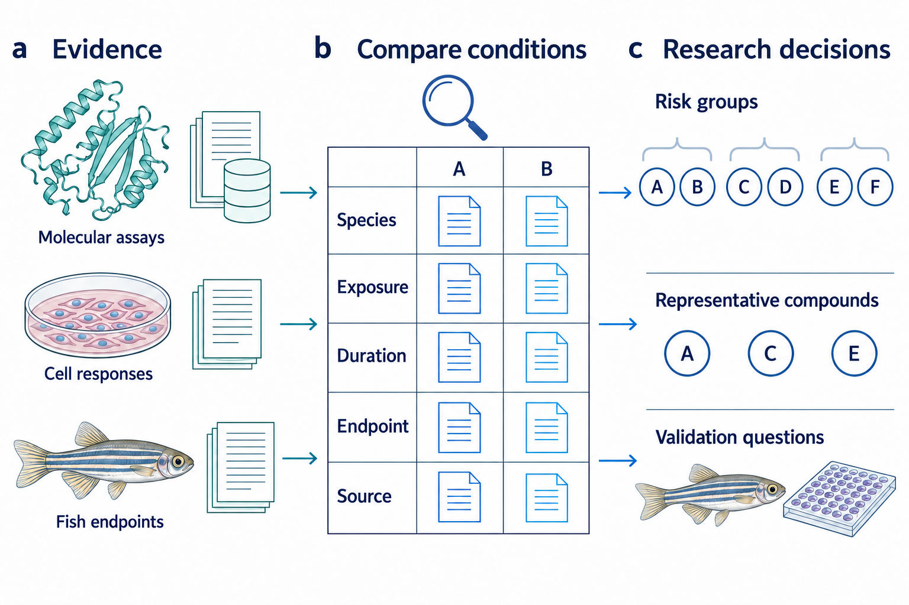
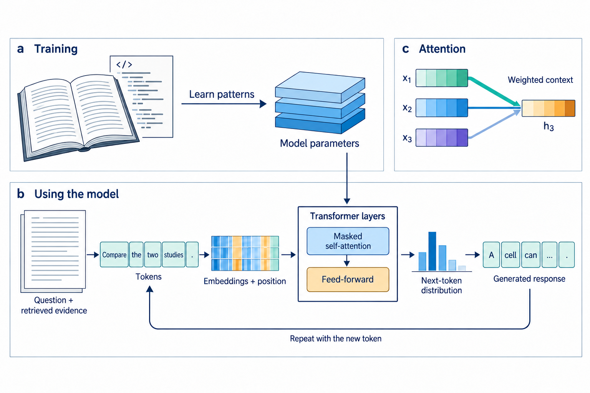
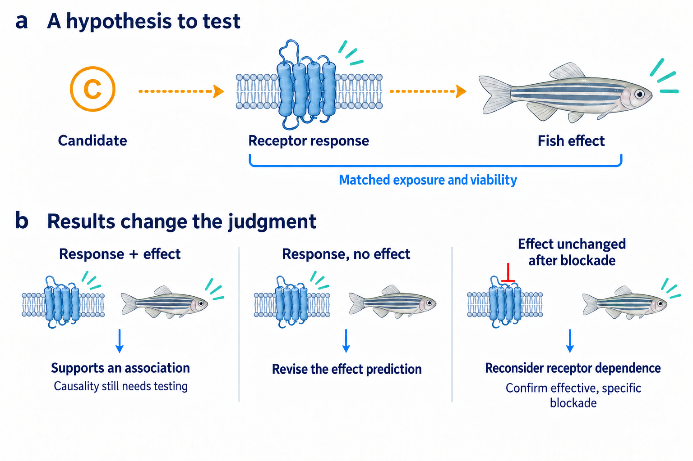

# How it works

[简体中文](工作原理.md) · [Project overview](../README.md) · [Installation](INSTALL.en.md)

The Fish Toxicology Research Plugin uses an LLM to analyze papers, experimental records and computational results, comparing the potential effects of organic pollutants in fish. The analysis explains what each compound may do and how that judgment was reached, helping researchers decide which compounds to test first and which questions the experiments should answer.

## Why use AI?

Comparing a group of compounds involves repeatedly searching papers, extracting experimental conditions and connecting molecular, cellular and fish-level findings. As the number of compounds and papers grows, organizing and comparing this material takes substantial time. We use LLMs for three main capabilities:

- **Reasoning across complex relationships.** LLMs can draw on knowledge from different fields to analyze structural changes, protein activity, exposure conditions and whole-organism effects step by step, comparing several explanations. Co-Scientist, for example, used LLMs to develop and compare biomedical hypotheses, with experimental testing in the applications studied. [Co-Scientist, 2026](https://www.nature.com/articles/s41586-026-10644-y)
- **Reducing time spent organizing large volumes of material.** LLMs can process literature screening, extraction of experimental conditions and table preparation in sequence, reducing repeated searching and data entry. In the LEADS medical-literature study, experts using a specially trained LLM spent less time on both screening and data extraction. [Wang et al., 2025](https://www.nature.com/articles/s41467-025-62058-5)
- **Connecting retrieval and computation.** An LLM can choose tools for a task, read their results and plan the next step, reducing the need to switch manually between papers, databases and computational programs. ChemCrow applied this approach to chemistry queries, calculations and synthesis planning. [ChemCrow, 2024](https://www.nature.com/articles/s42256-024-00832-8)

The plugin applies these capabilities to individual compound analysis, risk grouping and experimental selection, helping the team focus on differences in biological effects and plans for testing them.

**Figure 1 | Comparing compounds.** Molecular, cellular and fish studies are compared by species, exposure, duration, endpoint and source to inform risk groups and compound selection.

## How an LLM processes the material

**Training provides a basis for working with language and concepts.** An autoregressive LLM learns by predicting subsequent text fragments and adjusting its parameters. Large-scale training captures statistical relationships among words, concepts and forms of expression. Instructions and examples in the current context can guide the model on a new task, supporting reading, summarization and comparison. [Brown et al., 2020](https://arxiv.org/abs/2005.14165)

**A Transformer combines information in context.** Text is split into fragments called tokens and converted into numerical vectors with position information. Self-attention assigns weights to information at different positions; feed-forward networks further transform these representations. Repeated layers allow a word's representation to change with its context. For example, when processing a statement about decreased receptor activity, the surrounding description of the experimental system, treatment and assay also enters the computation. [Vaswani et al., 2017](https://proceedings.neurips.cc/paper/7181-attention-is-all-you-need.pdf)

**The response is generated incrementally.** At use time, the model uses its trained parameters to compute a distribution over the next token from the current context. Each new fragment extends that context for the next generation step. The plugin supplies the research question, retrieved source text and tool results as context for the task.

**Figure 2 | An autoregressive Transformer schematic.** a, training; b, use; c, attention as weighted information combination. Weights and probability bars illustrate the computation.

## How the plugin applies these capabilities

**The database provides research material.** The SQLite database and its frontend contain chemical identities and structures, experimental conditions and effects, proteins and sources. The LLM retrieves records for each compound, reads the original material and searches for additional public information needed by the study, then adds these materials to the analysis context. Using retrieved material to inform a generated response is the basic principle of retrieval-augmented generation (RAG). [Lewis et al., 2020](https://arxiv.org/abs/2005.11401)

**The research skill guides risk comparison.** The LLM examines each compound's expected effects relative to a reference, explains which findings support that interpretation and which conflict with it, and identifies the experimental conditions to which the prediction applies. It then ranks or groups all compounds in the study. When research conclusions conflict, the analysis examines differences in species, exposure or measurement level, explains how they affect the judgment and identifies questions for further investigation.

**Tools run queries, calculations and exports.** The LLM requests a query or calculation, a program executes it and returns the result, and the LLM continues the analysis. The plugin includes data extraction, calculation-record checks, plotting and export tools. Specialized calculations, such as molecular docking, are configured for the study. Figures, XLSX and the web report present the comparisons and explanations from the same reviewed analysis.

## How the analysis helps with experiments

Researchers first receive a comparison of the full group of compounds: which are expected to have stronger effects, which may be tied and how these judgments follow from the literature and computational results. Available experimental slots are then assigned to compounds that answer distinct questions. One might test a stronger predicted effect, another distinguish two mechanistic explanations, and another test whether a structural change alters activity. A reference compound provides a common basis for comparison.

For each selected compound, the analysis also states which possible result would change which judgment. The following teaching example considers whether a receptor response contributes to an effect in fish.

**Figure 3 | An example of testing receptor involvement.** Dotted arrows indicate proposed links. The interpretations below assume comparable exposure, assessed viability, and an observation window and assay sensitivity sufficient to detect expected effects or differences.

| Possible observation | Effect on the judgment |
| --- | --- |
| Both the receptor response and fish effect occur | Adds support for an association; test whether the receptor contributes to the effect. |
| The receptor responds, but the fish effect is absent | Lower the predicted fish effect under these conditions and reassess the inference from receptor response to the whole-organism endpoint. |
| The fish effect is essentially unchanged after effective, specific receptor blockade | Reduce support for dependence on that receptor and investigate other pathways. |

Experimental results update the relevant compound's assessment and inform reconsideration of untested members with similar mechanisms and conditions. Project files retain the study materials, explanations and open experimental questions so the team can discuss compound selection, plan experiments and continue the study.
